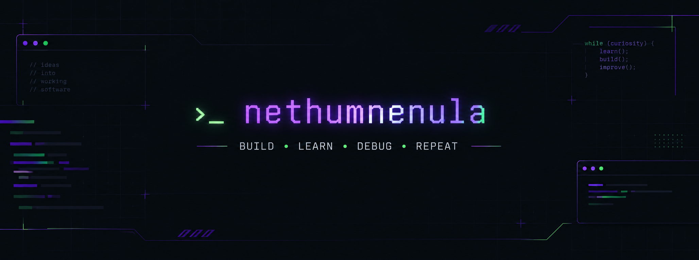

<!--
  PROFILE README
  Repository: nethumnenula/nethumnenula
  Banner: upload your generated banner to assets/profile-banner.png
-->

<div align="center">



<br/>


<br/>

[](https://github.com/nethumnenula)
[](https://nethumnenula.github.io/portfolio_1/)

</div>

---

## `whoami`

```bash
$ whoami
nethumnenula

$ cat about.txt
ICT undergraduate | Developer | Curious problem solver

$ current_mission
Build useful software.
Understand the systems behind it.
Keep getting better.
```

Hey! I'm an ICT undergraduate who enjoys building software and exploring how things work under the hood.

I work across desktop and web development, with experience in Java, JavaScript, databases, and full-stack application development. I'm currently expanding my knowledge into Python, cloud computing, AI/ML, and data science.

- 🚗 Building **EasyPark**, a parking reservation platform
- 🌐 Developing web applications with the MERN stack
- ☕ Exploring object-oriented programming and software design
- 🧠 Learning new technologies by building practical projects
- ⚡ Fun fact: I enjoy debugging almost as much as building things. Almost.

---

## `./tech-stack.sh`

### Languages

<p>


</p>

### Web Development

<p>


</p>

### Databases & Tools

<p>


</p>

---

## `ls ./projects`

### 🚗 EasyPark — Parking Reservation Platform

A team-based MERN application designed to let users find and book available parking spaces. The project includes authentication and booking-related functionality, with QR-based booking confirmation as a key feature.

**Stack:** React · Node.js · Express.js · MongoDB · Mongoose

[](https://github.com/Z-ombi-E/test_EasyPark)

### 🌐 Personal Portfolio

A React-based portfolio built with Vite to showcase my work and development journey, with GitHub Pages deployment.

**Stack:** React · Vite · JavaScript · CSS

[](https://github.com/nethumnenula/portfolio_1)

### ☕ Java Sales Management System

An academic desktop application built with Java Swing and MySQL, featuring product and customer management, sales transactions, and invoice generation.

**Stack:** Java · Swing · JDBC · MySQL

> Repository link can be added here when the project is published on GitHub.

---

## `git status --learning`

Currently exploring and strengthening my skills in:

- Python and Java Object-Oriented Programming
- Cloud Computing and Deployment
- Artificial Intelligence and Machine Learning
- Data Science and Business Intelligence
- Full Stack Development with MERN Stack
- Cross-platform Mobile Development with React Native

---

## `git log --github-stats`

<div align="center">


<br/>


<br/>


</div>

---

## `./connect.sh`

<div align="center">

**Interested in collaborating, building something interesting, or talking tech?**

[](https://github.com/nethumnenula)

<br/>

```text
while (curiosity) {
    learn();
    build();
    debug();
    improve();
}
```

**`BUILD • LEARN • DEBUG • REPEAT`** ⚡

</div>
